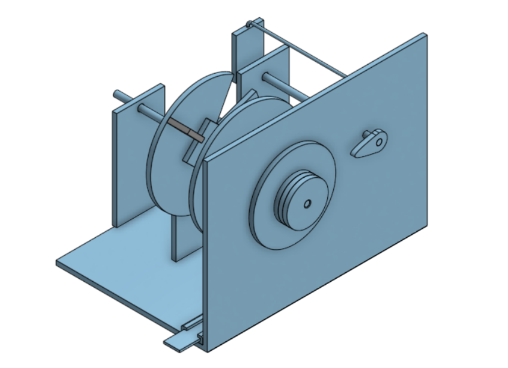
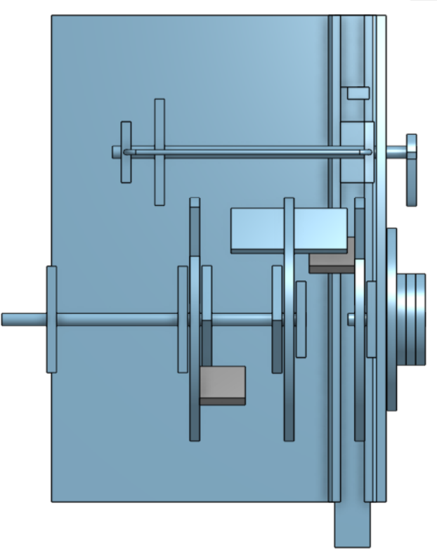
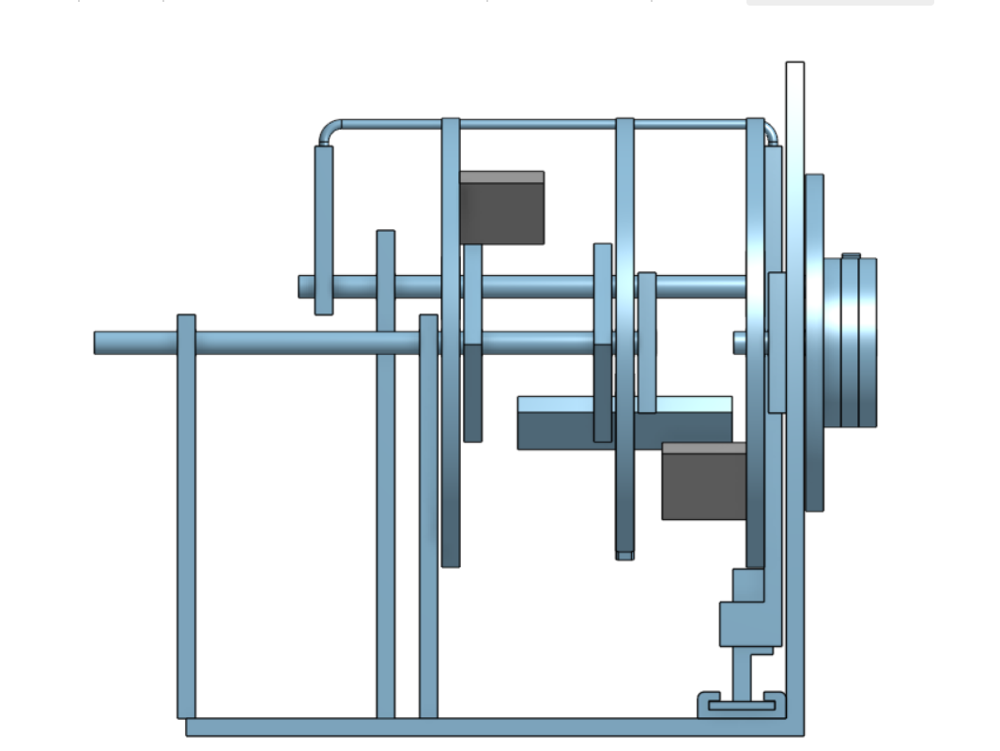

# week 2: 3d combination lock

## project goals
* **Target Specs:** parametric 3D printable combination padlock featuring rotating code wheels, internal alignment gates, a central locking spindle and a custom shackle designed entirely in Onshape.
* **Design Philosophy:** take a cardboard padlock tutorial and translate it into complex parametric CAD models while fighting onshape mate constraints and clearance limits [если cardboard can hold a safe together, high tech plastic definitely can].
* **Why I'm building this:** week 2 theme is CAD and i wanted to suffer through multi-part assemblies and mechanical tolerances instead of just drawing simple boxes.

## deep brief
inspired by the instructables guide on building a cardboard combination padlock (`https://www.instructables.com/How-to-Build-a-Cardboard-Combination-Padlock/`), this project reimagines a papercraft mechanism into a fully functional 3D CAD assembly. instead of cutting corrugated cardboard with a craft knife, every single gear, disc and locking pin is engineered in onshape. the lock operates using a series of rotating combination wheels with internal gates, a central shaft and a locking lever that blocks the shackle until all correct digits align. designing this required calculating precise mechanical clearances so the printed parts rotate smoothly rather than fusing together into an expensive plastic paperweight.

## bill of materials (BOM)
|Parts                    |Quantity|Pieces in a pack  |Cost |Cost w/ shipping|
|-------------------------|--------|------------------|-----|----------------|
|Hinge                    |1       |4                 |3.11 |3.58            |
|Super Glue               |1       |1                 |3.15 |3.15            |
|Sandpaper(220 Grit)      |1       |4                 |2.96 |2.96            |
|Isopropyl Alcohol(IPA)   |1       |1                 |1.76 |1.76            |
|5mm Sticks               |1       |50                |2.54 |2.54            |
|3D Print Parts(2kg spool)|1       |27 prints in total|12.64|16              |
|                         |        |                  |     |                |
|                         |        |                  |     |29.99           |

## visual showcase

*(a clean render of the combination lock looking completely functional until you try to turn the dials)*

*(an exploded view showing all the tiny internal wheels and pins i spent hours constraining)*

*(cross-section view of the internal gates aligning perfectly with the locking lever)*

*note: the combination is currently set to a secret code that i will probably forget immediately.*
